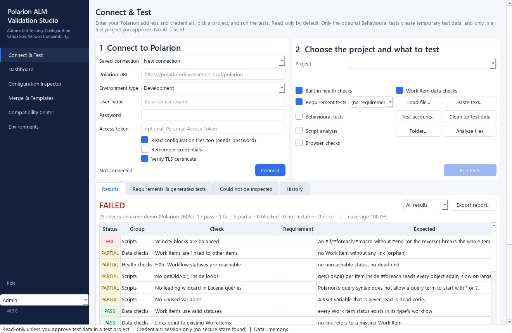
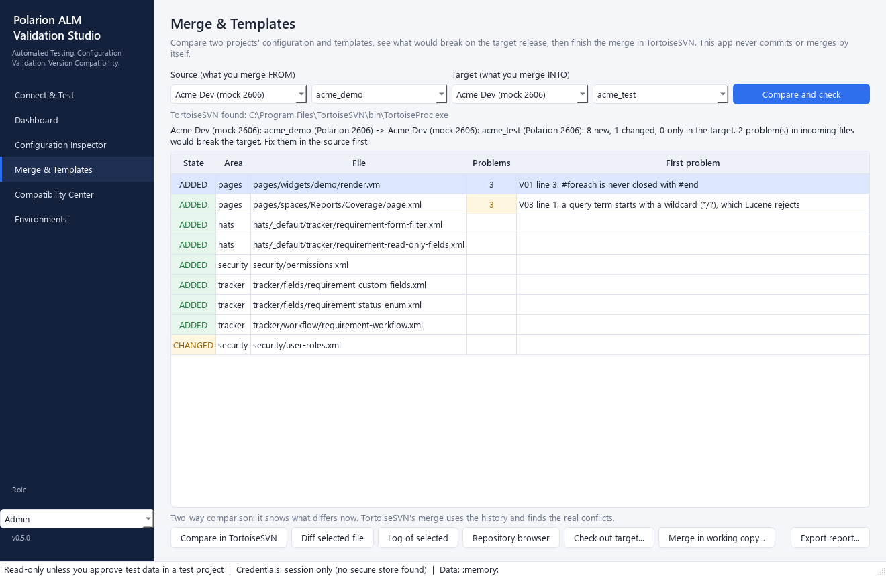
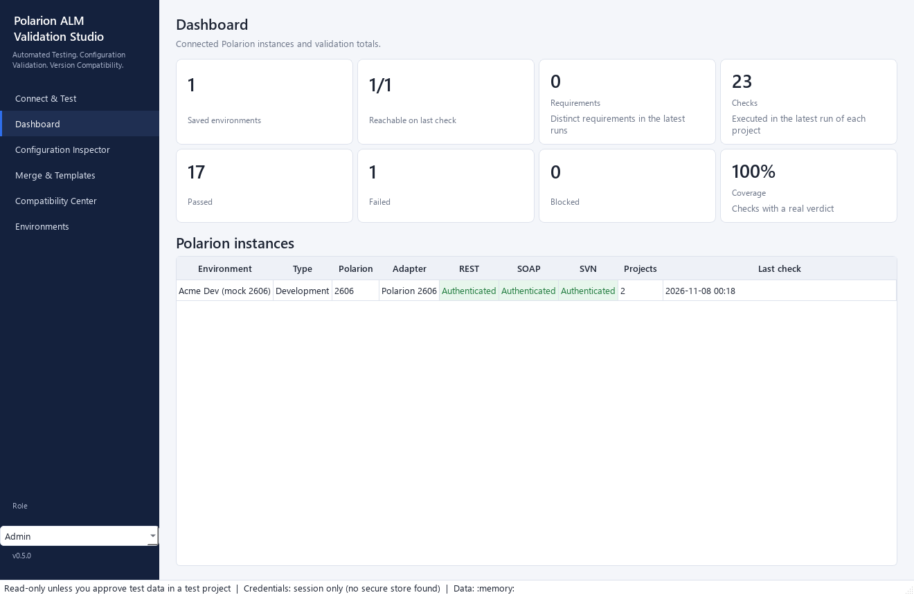
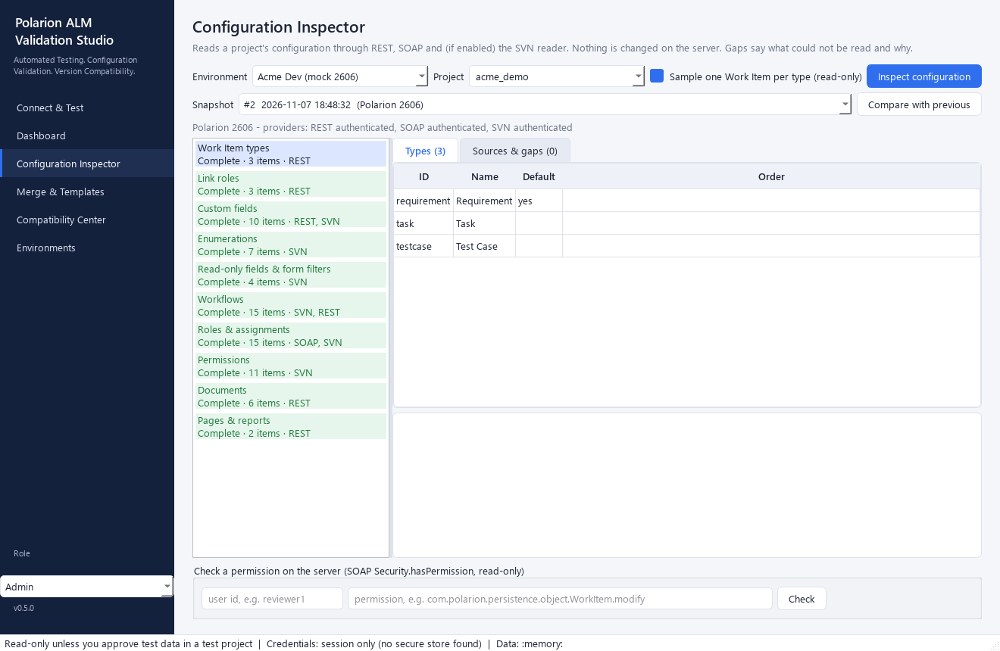

# Polarion ALM Validation Studio

*Automated Testing. Configuration Validation. Version Compatibility.*

A Windows desktop application that connects to Siemens Polarion ALM servers, reads a project's configuration, and tests it: built-in consistency checks, plus your own requirements turned into checks by fixed rules. **No AI or language model is used anywhere.** Read-only by default; the optional behavioural tests create temporary test data only in a test project you approve.

**Status: version 0.5.0, all six phases built.** Tested against a mock Polarion (every release profile), the real local Polarion 2606 (login page, version, repository files, templates, browser login page) and the packaged executables. **Not yet run with real Polarion credentials.** See [docs/ROADMAP.md](docs/ROADMAP.md) for what that leaves unverified.

| Document | What |
|---|---|
| [docs/ARCHITECTURE.md](docs/ARCHITECTURE.md) | Technical design: engines, providers, version/capability architecture, safety, phase plan |
| [docs/COMPATIBILITY.md](docs/COMPATIBILITY.md) | Generated capability matrix per release + checks done on real servers |
| [docs/ROADMAP.md](docs/ROADMAP.md) | Phase status and open questions |

## Screenshots

Taken against the bundled mock Polarion (invented data), so they show the app, not a real system.

| | |
|---|---|
|  |  |
|  |  |

## How to use it

1. Double-click **Start Polarion Validation Studio.bat** (or run `.\run.ps1`), or use the built `PolarionValidationStudio.exe`. Starting it again while it is open just brings the open window to the front; for a second, independent window use the **New window** button, `qa new`, or `--new`.
2. **Connect & Test** page: enter the Polarion URL (e.g. `https://polarion-dev.example.local/polarion`), your user name and password (or a Personal Access Token) and press **Connect**. Tick *Remember credentials* only if you want them kept in Windows Credential Manager.
3. Pick the **project** from the list.
4. Choose what to test, then **Run tests**:
   - **Built-in health checks** (14): workflows (every status exists, transitions and actions agree, no unreachable or dead-end status, fields used by actions exist), custom-field enumerations exist, enumeration options valid, link roles consistent, role assignments use defined roles, permission customsets defined, documents use defined types with workflows, read-only rules use existing statuses.
   - **Requirement tests**: *Load file...* (txt, md, csv, xlsx, docx, pdf, json, yaml) or *Paste text...*. Fixed rules turn the sentences into checks ([which sentences are understood](docs/REQUIREMENT-PATTERNS.md)); untick any you don't want.
   - **Work Item data checks** (read-only): statuses valid for each type, links pointing at existing items, unlinked items. Traceability requirements are measured on the real data (for example *3 of 4 Requirements are linked to a Test Case, 75%*).
   - **Behavioural tests** (optional, see below).
5. Read the **Results** (click a row for expected, actual and evidence), then **Export report...** (Excel, HTML or CSV). Earlier runs are under **History**.

For the most complete results use a **username + password** with *Also read configuration files* ticked: that lets the tool read workflow definitions and permission files. With only a token (REST) or only SOAP, some checks say **BLOCKED** and explain what to enable.

## Behavioural tests (Phase 4): the only part that changes anything

They are **off by default** and only run when you tick *Behavioural tests* and approve the project. They really try things instead of reading configuration:
- **Workflow:** creates a temporary Work Item in the starting status, checks the server offers the action, runs it, and confirms the new status.
- **Permissions:** signs in as a **test account** (a real Polarion user holding the role, with its Personal Access Token) and really tries read / modify / delete / create / comment, to confirm what the role may and may not do.
- Needs **REST** (a Personal Access Token and REST enabled). Without REST they are reported BLOCKED and nothing is written.

How it is kept safe (each rule is enforced in code and covered by tests):
- Writes are refused unless you approved **that project** for test data (a dialog explains exactly what will happen). Use a dedicated TEST project, never your working project.
- A **production** environment additionally needs its exact name typed every time.
- Every temporary Work Item is titled `[PAVS-<run>]`, recorded at once, capped at 30 per run, and **deleted at the end of the run even if something crashes**. A tool-created item is only deleted if its title still carries the tag.
- *Clean up test data* removes leftovers from an earlier crashed run. The audit log records every approval, run and cleanup.
- If a test account lacks REST endpoint permissions, the result is **BLOCKED**, never a false pass.

## What the tool never does
- Outside behavioural tests it never creates, changes or deletes anything in Polarion (asserted by the tests).
- It never uses AI. Test cases come from fixed rules; results come only from executed checks with evidence.
- Passwords and tokens are never written to the database, logs or reports.

## What Phases 5 and 6 add
- **Script analysis** (tick *Script analysis*, optionally *Folder...*): read-only static analysis of Polarion scripts (`.js`) and Velocity templates (`.vm`, including the Script blocks inside pages) for syntax errors, secrets, Nashorn-only code, API methods **missing in your Polarion release** (from the SDK change log), and the bug patterns in your own scripting notes. *Analyze files* checks a folder without any Polarion connection. Rules: [docs/SCRIPT-RULES.md](docs/SCRIPT-RULES.md).
- **Regression comparison:** after each run the result line shows how many checks got worse or were fixed since the previous run of the same project; *History > Compare with previous run* lists every difference, worst first.
- **Merge & Templates with TortoiseSVN** (own page): pick a source and a target project (same server or two servers), and the tool compares their configuration trees (`<project>/.polarion`: workflows, fields, roles, pages, widget templates, scripts) **read-only**, lists what is new / changed / only in the target, and checks every incoming file: well-formed XML, and the script and Velocity rules against the **target** Polarion release. Then buttons start TortoiseSVN's own dialogs: compare URLs, diff of the selected file, log, repository browser, **checkout of the target** and the **merge wizard** on your working copy. The tool never commits or merges by itself, never puts a password on a command line (TortoiseSVN uses its own cached sign-in), and the checkout/merge hand-offs need the Lead role (Admin for a production environment). It is a two-way comparison; TortoiseSVN's merge uses the history to find real conflicts. Needs TortoiseSVN installed (found automatically).
- **Browser checks** (tick *Browser checks*, optional): drives your installed Edge or Chrome through Playwright (`pip install playwright`, no download): login page renders, sign-in works, the project page opens, no JavaScript errors. Nothing is clicked except the sign-in. Without Playwright or a browser the checks say BLOCKED and why.
- **Local repository reader:** when Polarion runs on the same computer and `/repo` refuses the login, the configuration files are read straight from the repository folder (for example `E:\data\svn
epo`) with the `svnlook` that ships with Polarion. Read-only, no repository login needed. Found automatically for `localhost`; for another folder use *Local repository folder* on the Connect page. A remote server still needs a working `/repo` login (*Repository user / password*).
- **JWT / Bearer tokens:** paste a JWT in *Access token*; it is used for REST. SOAP cannot use a JWT, so add the password for SOAP.
- **PDF reports** besides Excel, HTML and CSV. Every export scrubs secrets and neutralises spreadsheet formulas.
- **Application roles** (Viewer, Tester, Lead, Admin; selector at the bottom of the sidebar): Viewer looks at saved results; Tester connects and runs read-only tests; Lead also runs behavioural tests, approves test projects and starts TortoiseSVN checkout/merge; Admin also manages production environments, deletes environments and sets an optional role passphrase (needed to raise the role). A guardrail for a desktop tool, not a security boundary: Polarion's own permissions and the Write Guard are unchanged.
- **Command line** (`pavs-cli`, for schedulers and build pipelines): `scripts`, `projects`, `run`, `compat` (writes a Markdown/JSON compatibility record of what this server supports, with what a real call verified) and `merge-check`. Passwords come from `PAVS_USER`, `PAVS_PASSWORD`, `PAVS_TOKEN` in the environment, never from arguments. Exit code 0 passed, 1 a check failed, 2 could not run.
- **Windows executables** (PyInstaller): `tools/build_exe.ps1` builds one folder with `PolarionValidationStudio.exe` and `pavs-cli.exe`.
- **Not built:** read-only database queries (the SVN reader plus REST/SOAP already cover configuration and data; a database login would add access without adding checks).

## What Phase 4 adds
- Real **link coverage** for "every X must be linked to a Y" requirements, and three data checks (D01 statuses, D02 broken links, D03 orphans).
- **Behavioural tests** with test accounts and guaranteed cleanup (above), an approval dialog, a *Test accounts...* dialog and a *Clean up test data* button.
- Environment type (Development / Test / Staging / Production) chosen on the Connect page.
- 21 new tests, including proofs that nothing is written without approval, writes never leave the approved project, production needs the typed name, and cleanup runs even when a run crashes.

## What Phase 3 adds
- The **Connect & Test** page above, with project picker, results, history and export.
- Requirement import (txt, md, csv, xlsx, docx, pdf, json, yaml), acceptance-criteria extraction, rule-based test generation, findings (not automatable, ambiguous, missing criteria, conflicting requirements).
- 14 health checks, validated on a real Polarion 2606 project (`drivepilot`): all pass there, and each detects its problem when the configuration is deliberately broken.
- Permission checks are confirmed by **the server** for a real user holding the role (SOAP `hasPermission`), not guessed from files.

## What Phase 1 does

- Saves several Polarion environments (Development / Test / Staging / Production). Secrets go to **Windows Credential Manager**; the database and logs never contain them.
- Connects through three providers: **REST** (PAT), **SOAP** (PAT or username/password), and an opt-in **read-only SVN configuration reader**.
- **Detects the Polarion release without credentials** from four signals (login-page build id, version text, SDK change log, live REST spec), and from `/metadata` when signed in on 2512+.
- Resolves **34 capabilities** per server (supported / partial / unsupported / needs permission / unknown) by capability detection first (live REST spec, live WSDL, probes) and the documented endpoint catalog second. Version adapters exist for 2410, 2506, 2512, 2606, plus a Future adapter.
- Discovers the current user and projects (REST, or SOAP when REST is off, as on a locked-down 2410 server).
- **Read-only by default.** Every request passes a Write Guard; writes need an explicit authorization for an allowed test project, and production needs typed confirmation.
- Records every HTTP exchange (redacted) as evidence; keeps an append-only audit log.

## What Phase 2 adds

- **Configuration Inspector:** reads a project's Work Item types, link roles, custom fields (effective per type + the global/project files they come from), enumerations, read-only fields and form filters, workflows (definitions + live actions for one item per type), roles and assignments, permission rules, documents and pages.
- Each section shows which provider it used and what it could *not* read and why (e.g. "permissions.xml needs the SVN reader"), so gaps are never silent.
- **Check a permission:** asks the server directly (SOAP `hasPermission`) whether a user has a permission in a project.
- **Snapshots:** every inspection is stored; two snapshots can be compared to see what changed in the configuration.

## Run it

Python 3.11+. On this machine the virtual environment lives on D: because C: is nearly full.

```powershell
.\run.ps1            # creates D:\PolarionValidationStudio\venv on first run, then starts the app
.\run.ps1 -Test      # runs the test suite
```

Manual equivalent:

```bash
python -m venv D:/PolarionValidationStudio/venv
D:/PolarionValidationStudio/venv/Scripts/python -m pip install -e ".[dev]"
D:/PolarionValidationStudio/venv/Scripts/python -m pavs
```

App data (SQLite database, logs) goes to `%LOCALAPPDATA%\PolarionValidationStudio`, or to `PAVS_DATA_DIR` if set (`run.ps1` sets it to `D:\PolarionValidationStudio\data`).

### Try it without a real server

```bash
python -m mock_polarion.serve 2410-rest-off --port 8810
```

Add an environment with URL `http://127.0.0.1:8810/polarion`, authentication "Username + password", user `admin`, password `admin-test-pw` (mock-only fake values). Profiles: `2410-rest-off`, `2410`, `2506`, `2512`, `2606`.

### Check everything on this machine

`qa check` runs 47 end-to-end scenarios (all release profiles, GUI, CLI, executables, security, browser checks); see [docs/TESTING-GUIDE.md](docs/TESTING-GUIDE.md).

### Build the executables

```powershell
powershell -ExecutionPolicy Bypass -File .\tools\build_exe.ps1 -OutDir D:\PavsBuild
```

(or `python -m PyInstaller --noconfirm --distpath <out>/dist --workpath <out>/work packaging/pavs.spec`). Browser checks need Playwright inside the exe: add `-BundlePlaywright` (about 100 MB more); otherwise they report BLOCKED.

## Develop

- Layering: `ui → services → engines → polarion core → infra`; `domain` is shared. The UI never imports `pavs.polarion`.
- Regenerate the REST endpoint catalog after a Polarion upgrade: `python tools/build_endpoint_catalog.py <polarion>/polarion/sdk/doc/rest`
- Regenerate the compatibility doc: `python tools/render_compatibility.py`
- Tests never touch the network, the OS credential store, or your data folder (see `tests/conftest.py`).
